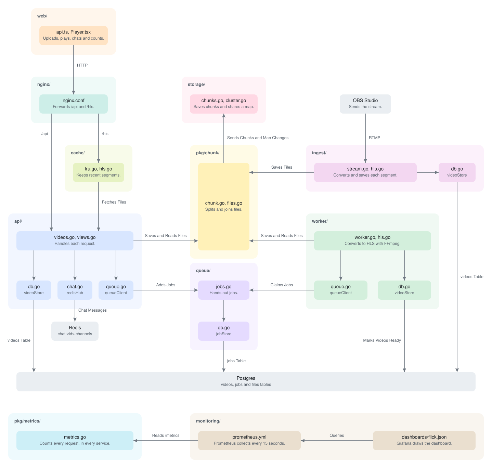

# Flick

A video platform built from the storage up. Upload a video, and workers convert it in the background while you wait.

## Architecture



| Folder | Job | Docs |
| --- | --- | --- |
| `web/` | The React site: upload form, video grid and watch page. | |
| `nginx/` | Serves the site and forwards `/api` requests to the API. | |
| `api/` | Saves uploads, lists videos, and asks the queue to convert them. | [README](api/README.md) |
| `queue/` | Hands out one job per worker, and retries jobs stuck for 5 minutes. | [README](queue/README.md) |
| `worker/` | Converts each video to 720p, then marks it ready. | [README](worker/README.md) |

`storage/`, `cache/`, `ingest/` and `monitoring/` are placeholders for later phases. See the [roadmap](docs/phases/README.md) and the [full planned architecture](docs/architecture.svg).

## Running It

Requires Docker Desktop.

```sh
docker compose up --build
```

Open http://localhost. Add `--scale worker=2` to run two workers.
