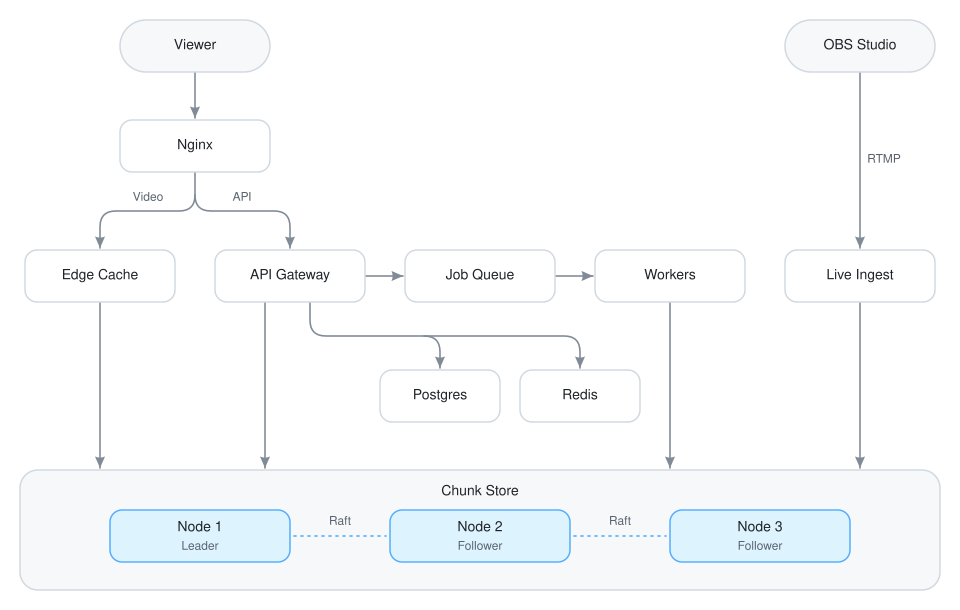

# Flick

A video platform built from the storage up. Upload videos, watch them in adaptive quality, and stream live with chat, all running on a fault tolerant storage cluster written in Go.

## Architecture



| Component | Folder | Job |
| --- | --- | --- |
| Nginx | `nginx/` | Serves the site and routes requests. |
| API Gateway | `api/` | Handles uploads, video lists and chat. |
| Job Queue | `queue/` | Assigns conversion jobs and retries failures. |
| Workers | `worker/` | Convert videos with FFmpeg. |
| Chunk Store | `storage/` | Stores every file three times. |
| Edge Cache | `cache/` | Keeps popular segments in memory. |
| Live Ingest | `ingest/` | Turns live streams into segments. |
| Postgres | | Stores video records. |
| Redis | | Relays chat and counts views. |
| Prometheus, Grafana | `monitoring/` | Collect and show metrics. |
| Website | `web/` | React frontend. |

## Running It

Requires Docker Desktop.

```sh
docker compose --profile full up --build
```

| Open | For |
| --- | --- |
| http://localhost | Website |
| http://localhost:3001 | Grafana dashboards |
| http://localhost:9090 | Prometheus |

Built with Go, React, FFmpeg, HLS, Raft, Postgres, Redis, Nginx and Docker.
