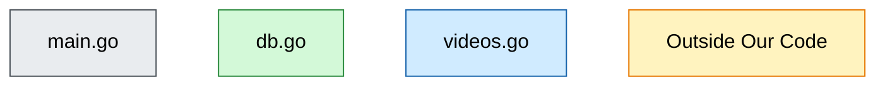
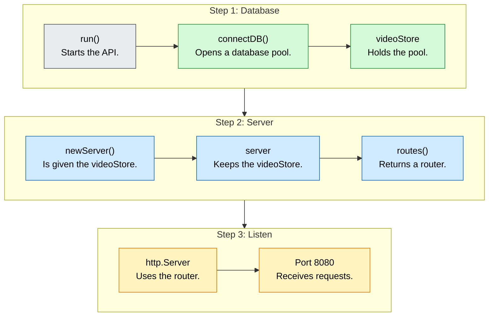
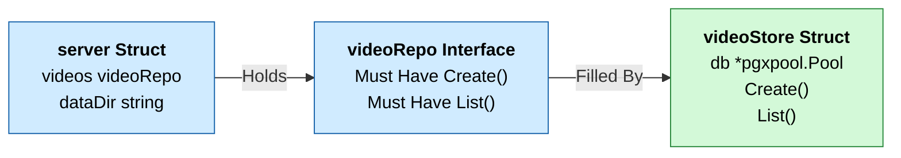
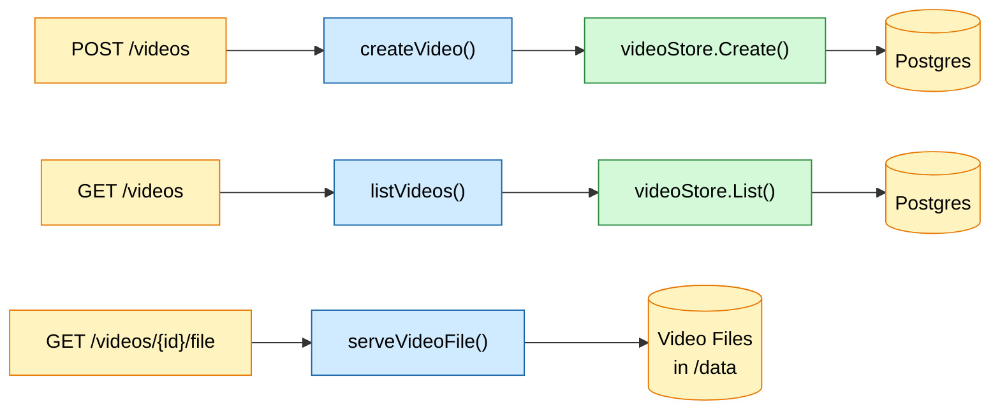

# API Design



## How the API Starts



All three steps happen in one line of `run()`:

```go
newServer(&videoStore{db: db}, dataDir).routes()
```

## How the Types Connect



## How a Request Is Handled

`routes()` sends each request to its handler.



## Functions

| Function | File | Belongs To | Description |
| --- | --- | --- | --- |
| `main` | main.go | | Starts the program by calling `run`. |
| `run` | main.go | | Sets everything up, serves requests, and shuts down cleanly. |
| `getenv` | main.go | | Reads a setting, or returns a default. |
| `connectDB` | db.go | | Opens the database pool and creates the `videos` table. |
| `pingWithRetry` | db.go | | Waits until Postgres is ready, trying up to 10 times. |
| `Create` | db.go | `videoStore` | Adds a video row. |
| `List` | db.go | `videoStore` | Returns every video, newest first. |
| `newServer` | videos.go | | Builds a `server` from a `videoStore` and the data folder. |
| `routes` | videos.go | `server` | Connects each URL to its handler. |
| `createVideo` | videos.go | `server` | Saves an upload to disk, then adds its row. |
| `listVideos` | videos.go | `server` | Sends every video as JSON. |
| `serveVideoFile` | videos.go | `server` | Sends a video file so the browser can play it. |
| `health` | videos.go | `server` | Replies `ok`. |
| `videoPath` | videos.go | `server` | Builds a file path, such as `/data/<id>.mp4`. |
| `readTitle` | videos.go | | Reads and trims the uploaded title. |
| `saveFile` | videos.go | | Copies the uploaded file to disk. |
| `uploadError` | videos.go | | Picks the error reply for a failed upload. |
| `internalError` | videos.go | | Logs an error and replies with a 500. |
| `writeJSON` | videos.go | | Sends data as JSON. |
