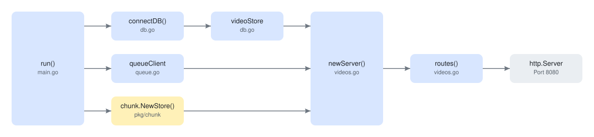

# API

Saves uploads on the storage nodes, records them in Postgres, and asks the queue to convert them. It also sends HLS files to the cache, and passes chat messages between viewers through Redis.

## Startup

## Requests

| Request | Reply |
| --- | --- |
| `POST /videos` | `201` with the new video. `400` for a bad form, `413` for a file over 2 GB, and `503` if the queue is full. |
| `GET /videos` | `200` with every video, newest first. |
| `GET /files/hls/<id>/<file>` | `200` with the HLS file. `404` if there's no such file. The cache asks for `/hls/...` files here. |
| `GET /chat/<id>` | `101` and a WebSocket to the stream's chat. `400` if the ID isn't a UUID, `403` if the page is on another site, and `500` if Redis can't be reached. |

## Chat Messages

| Field | Description |
| --- | --- |
| `name` | Who sent it, such as `Guest 4821`. Spaces are trimmed from both ends, and a message is skipped unless it's 1 to 50 characters. |
| `text` | The message, such as `Hi!`. Spaces are trimmed from both ends, and a message is skipped unless it's 1 to 500 characters. |
| Any Other Field | Dropped before the message is passed on. |

## Configuration

| Variable | Default | Description |
| --- | --- | --- |
| `PORT` | `8080` | The port the API listens on. |
| `QUEUE_URL` | `http://queue:8081` | Where the queue is. |
| `STORAGE_NODES` | `http://node1:9001,http://node2:9002,http://node3:9003` | Where the storage nodes are, separated by commas. |
| `REDIS_URL` | `redis://redis:6379` | Where Redis is. |
| `DATABASE_URL` | Required | Where Postgres is, such as `postgres://postgres:flick@db:5432/postgres?sslmode=disable`. |

## Development

| Command | Description |
| --- | --- |
| `go doc -cmd -u -all .` | Shows every function and type with its documentation. |
| `go test ./...` | Runs the tests. They need no Postgres, Redis or Docker. |
