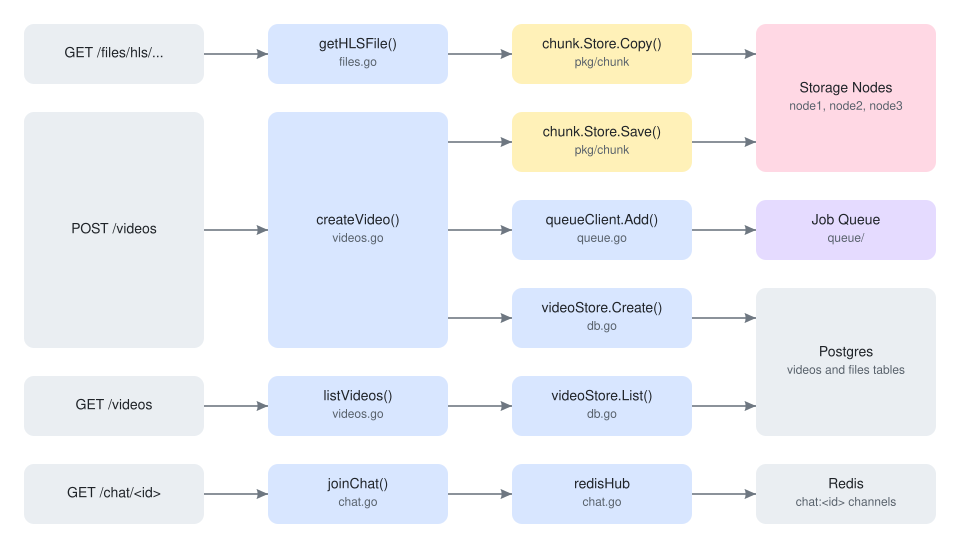

# API

Saves uploads on the storage nodes, records them in Postgres, and asks the queue to convert them. It also sends HLS files to the cache, passes chat messages between viewers through Redis, and counts views and watch time for the creator dashboard.

## Startup

## Requests

| Request | Reply |
| --- | --- |
| `POST /videos` | `201` with the new video. `400` for a bad form, `413` for a file over 2 GB, and `503` if the queue is full. |
| `GET /videos` | `200` with every video, newest first. |
| `GET /files/hls/<id>/<file>` | `200` with the HLS file. `404` if there's no such file. The cache asks for `/hls/...` files here. |
| `GET /chat/<id>` | `101` and a WebSocket to the stream's chat. `400` if the ID isn't a UUID, `403` if the page is on another site, and `500` if Redis can't be reached. |
| `POST /videos/<id>/view` | `204` once the view is counted. `400` if the ID isn't a UUID, and `500` if Redis can't be reached. |
| `POST /videos/<id>/watch` | `204` once the watch time in a body such as `{"seconds":30}` is counted. `400` if the ID isn't a UUID or the seconds aren't 1 to 60, and `500` if Redis can't be reached. |
| `GET /stats` | `200` with every video's `title`, `views`, `watch_seconds` and `created_at`, newest first. |
| `GET /metrics` | `200` with the API's numbers for Prometheus, such as `chat_connections`. |

## Chat Messages

| Field | Description |
| --- | --- |
| `name` | Who sent it, such as `Guest 4821`. Spaces are trimmed from both ends, and a message is skipped unless it's 1 to 50 characters. |
| `text` | The message, such as `Hi!`. Spaces are trimmed from both ends, and a message is skipped unless it's 1 to 500 characters. |
| Any Other Field | Dropped before the message is passed on. |

## Counting Views

| Step | Description |
| --- | --- |
| A Viewer Watches | The player reports a view when playback starts, and watch time every 30 seconds. |
| The API Counts | Each report adds to `views:<id>` or `watch:<id>` in Redis, and adds the ID to the `counted` set. Writing to Postgres every time would be slow with many viewers. |
| Every Minute | `flushLoop()` reads and deletes each video's counters with `GETDEL`, then adds them to the `views` and `watch_seconds` columns of `videos`, all in one transaction. |

## Special Cases

| Case | Description |
| --- | --- |
| Postgres Fails During a Flush | The counts go back into Redis, and the next flush tries again. None are lost. |
| A View Is Counted During a Flush | Each video's counters are read and deleted in one step, so the view is either in this flush or the next, never both. |
| Several Copies of the API Flush at Once | A video's counters can only be taken once, so the other copies find nothing to add. |
| The Video Doesn't Exist | The view is counted anyway, since checking Postgres would make every report slower. The flush matches no row, so it's dropped. |
| Redis Is Down | Uploads and playback still work. Chat and view counting reply `500` until it's back. |

## Configuration

| Variable | Default | Description |
| --- | --- | --- |
| `PORT` | `8080` | The port the API listens on. |
| `QUEUE_URL` | `http://queue:8081` | Where the queue is. |
| `STORAGE_NODES` | `http://node1:9001,http://node2:9002,http://node3:9003` | Where the storage nodes are, separated by commas. |
| `REDIS_URL` | `redis://redis:6379` | Where Redis is. |
| `DATABASE_URL` | Required | Where Postgres is, such as `postgres://postgres:flick@db:5432/postgres?sslmode=disable`. |

## Development

| Command | Description |
| --- | --- |
| `go doc -cmd -u -all .` | Shows every function and type with its documentation. |
| `go test ./...` | Runs the tests. They need no Postgres, Redis or Docker. |
