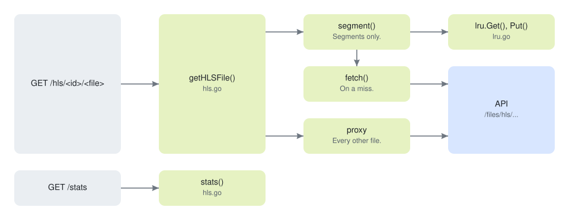

# Cache

Keeps recently watched segments in memory, so a popular video's segments are fetched from the API once instead of once per viewer. When it's full, it removes the least recently used segment.

## Startup

## Requests

| Request | Response |
| --- | --- |
| `GET /hls/<id>/<name>.ts` | `200` with the segment, from memory on a hit or from the API on a miss. `404` if there's no such segment. `502` if the API fails. |
| `GET /hls/<id>/<file>` | The API's response, passed through unchanged. This covers any other file, such as a playlist. |
| `GET /stats` | `200` with the hits, the misses and the hit rate, such as `{"hit_rate":0.95,"hits":95,"misses":5}`. Only segments are counted. |
| `GET /metrics` | `200` with the cache's metrics for Prometheus, including the same hits and misses as `cache_hits_total` and `cache_misses_total`. |

## Edge Cases

| Case | Description |
| --- | --- |
| A Playlist Is Requested | It's never cached. Playlists are tiny, and a live playlist changes every 2 seconds, so a cached copy would go stale. |
| Many Viewers Miss the Same Segment at Once | Only the first one fetches it from the API. The rest wait and share the result. |
| A Segment Is Missing | The cache returns `404` and caches nothing, so a video still processing can be fetched again once it's ready. |
| The Cache Is Full | It removes the least recently used segments until the new one fits. A segment bigger than the whole cache is sent but never cached. |
| The Cache Restarts | The cache starts empty, since it lives in memory. Each segment misses once, then hits again. |

## Configuration

| Variable | Default | Description |
| --- | --- | --- |
| `PORT` | `8082` | The port the cache listens on. |
| `API_URL` | `http://api:8080` | The API's URL. |
| `CACHE_MAX_MB` | `500` | The maximum size of the cache, in MB. Change it in `docker-compose.yml` and restart the cache. No rebuild is needed. |

## Development

| Command | Description |
| --- | --- |
| `go doc -cmd -u -all .` | Shows every function and type with its documentation. |
| `go test ./...` | Runs the tests. They use a fake API, so they need no Docker. |
