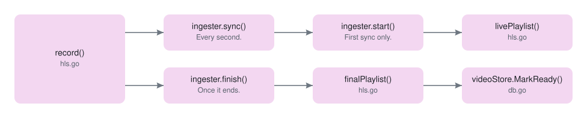

# Ingest

Takes live streams from OBS, converts each one to HLS as it comes in, and saves every segment on the storage nodes as soon as it's finished. When a stream ends, it becomes a normal video that anyone can replay.

## Startup

## Stream Steps

## Files

| File | Path | Description |
| --- | --- | --- |
| FFmpeg's Playlist | `record.m3u8` | Made by FFmpeg in a temporary folder, listing every segment so far. It's read every second, but never saved. |
| Segments | `hls/<id>/seg_00000.ts`, `seg_00001.ts` and so on | Made by FFmpeg, 2 seconds each, and saved as soon as each one is finished. |
| Poster | `hls/<id>/poster.jpg` | Made by FFmpeg from the first segment, and saved before the video is added. |
| Live Playlist | `hls/<id>/live.m3u8` | Lists the newest 6 segments. Saved again after each new segment. |
| Finished Playlist | `hls/<id>/master.m3u8` | Lists every segment, and is saved once the stream ends. It has the same name as an upload's master playlist, so the site plays both the same way. |

## Special Cases

| Case | Description |
| --- | --- |
| OBS Hasn't Connected | FFmpeg keeps waiting, and nothing is saved or added. |
| A Save Fails | It's tried again a second later, along with any newer segments. The live playlist is only saved once every segment it lists is saved. |
| A Save Fails as the Stream Ends | The video stays `live` until the next start, which removes it. |
| FFmpeg Fails Before a Stream | Waits 2 seconds, then starts FFmpeg again. |
| FFmpeg Fails Partway Through | Whatever was saved is kept, and the stream ends there. |
| The Service Is Stopped Mid-Stream | Stops FFmpeg, then finishes the stream with the segments made so far. |
| The Service Crashes Mid-Stream | The list of segments is lost with the temporary folder, so the stream can't be finished. At the next start, any stream still marked `live` is removed. Its files stay on the storage nodes. |

## Configuration

| Variable | Default | Description |
| --- | --- | --- |
| `STORAGE_NODES` | `http://node1:9001,http://node2:9002,http://node3:9003` | Where the storage nodes are, separated by commas. |
| `METRICS_PORT` | `8083` | The port Prometheus reads `/metrics` from. The service only speaks RTMP otherwise, so this small server is its only HTTP. |
| `DATABASE_URL` | Required | Where Postgres is, such as `postgres://postgres:flick@db:5432/postgres?sslmode=disable`. |

## Development

| Command | Description |
| --- | --- |
| `go doc -cmd -u -all .` | Shows every function and type with its documentation. |
| `go test ./...` | Runs the tests. They need no Postgres or Docker. `TestRecord` is skipped if FFmpeg isn't installed. |

## Additional Information: Live Playlists

A finished video's playlist never changes. A live stream's playlist changes every 2 seconds, as each new segment is finished.

| Topic | Description |
| --- | --- |
| What It Lists | Only the newest 6 segments, so it stays small however long the stream runs. |
| How the Player Uses It | hls.js loads it again every few seconds to find new segments, and plays about 6 seconds behind the newest one. |
| `#EXT-X-MEDIA-SEQUENCE` | The number of the first segment listed. It tells the player where the list now starts, so it knows which segments are new. |
| How Far Behind Viewers Are | About 6 seconds, measured from when the stream reaches the service. The player stays 6 seconds behind the end of the newest segment, and each segment is saved within a second of being finished. OBS adds a second or two of its own while it converts the video. |
| Why It Isn't Cached | The cache passes playlists straight through, and Nginx tells the browser `Cache-Control: no-cache`, so no one gets an old copy. Segments never change, so they're cached like any other. |
| When the Stream Ends | The finished playlist lists every segment, starts with `#EXT-X-PLAYLIST-TYPE:VOD` and ends with `#EXT-X-ENDLIST`. Those tell the player the video is finished, so it can be played from the start. |
