# Ingest

Takes live streams from OBS and converts each one to HLS as it comes in. It saves every segment on the storage nodes as soon as it's made. When a stream ends, it becomes a normal video that anyone can replay.

## Startup

## Stream Steps

## Files

| File | Path | Description |
| --- | --- | --- |
| FFmpeg's Playlist | `record.m3u8` | Made by FFmpeg in a temporary folder. It lists every segment so far. The service reads it every second but never saves it. |
| Segments | `hls/<id>/seg_00000.ts`, `seg_00001.ts` and so on | Made by FFmpeg, 2 seconds each. Each one is saved as soon as it's finished. |
| Poster | `hls/<id>/poster.jpg` | Made by FFmpeg from the first segment and saved before the video is added. |
| Live Playlist | `hls/<id>/live.m3u8` | Lists the newest 6 segments and is saved again after each new one. The player reloads it every few seconds and stays about 6 seconds behind the newest segment. |
| Finished Playlist | `hls/<id>/master.m3u8` | Lists every segment and is saved once the stream ends. It ends with `#EXT-X-ENDLIST`, which tells the player the video is finished. It has the same name as an upload's master playlist, so the website plays both the same way. |

## Edge Cases

| Case | Description |
| --- | --- |
| OBS Hasn't Connected | FFmpeg keeps waiting, and nothing is saved or added. |
| A Save Fails | It's retried a second later. The live playlist is only saved once every segment it lists is saved. |
| A Save Fails as the Stream Ends | The video stays `live` until the service restarts, which removes it. |
| FFmpeg Fails Before a Stream | Waits 2 seconds, then restarts FFmpeg. |
| FFmpeg Fails Partway Through | Whatever was saved is kept, and the stream ends there. |
| The Service Is Stopped Mid-Stream | Stops FFmpeg, then finishes the stream with the segments made so far. |
| The Service Crashes Mid-Stream | The list of segments is lost with the temporary folder, so the stream can't be finished. The next time the service starts, any stream still marked `live` is removed. Its files stay on the storage nodes. |

## Configuration

| Variable | Default | Description |
| --- | --- | --- |
| `STORAGE_NODES` | `http://node1:9001,http://node2:9002,http://node3:9003` | The storage nodes' URLs, separated by commas. |
| `METRICS_PORT` | `8083` | The port that serves `/metrics` to Prometheus. The service otherwise only speaks RTMP, the protocol OBS streams over. |
| `DATABASE_URL` | Required | The Postgres connection URL, such as `postgres://postgres:flick@db:5432/postgres?sslmode=disable`. |

## Development

| Command | Description |
| --- | --- |
| `go doc -cmd -u -all .` | Shows every function and type with its documentation. |
| `go test ./...` | Runs the tests. They need no Postgres or Docker. `TestRecord` is skipped if FFmpeg isn't installed. |
