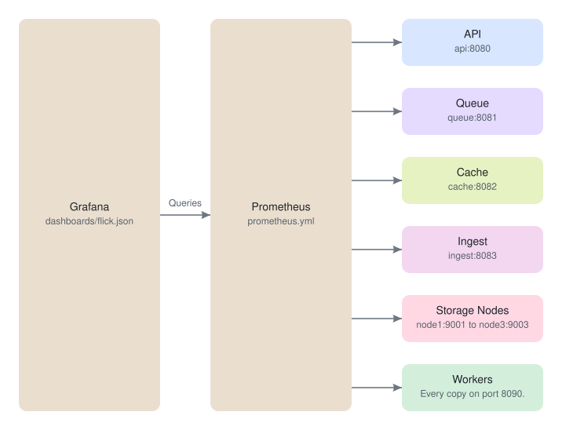

# Monitoring

Prometheus reads the numbers from every service every 15 seconds and keeps them. Grafana draws them as live charts on one dashboard, so you can see which part slowed down or failed, and when.

## Collecting

| File | Description |
| --- | --- |
| `prometheus.yml` | Lists every service Prometheus reads from. Each kind of service is its own job, so the dashboard can show each one apart. Workers are found through Docker, since any number of them can run. |
| `grafana/datasource.yml` | Connects Grafana to Prometheus. |
| `grafana/dashboards.yml` | Tells Grafana to load every dashboard in `grafana/dashboards/` when it starts. |
| `grafana/dashboards/flick.json` | The Flick dashboard. It comes back by itself even if Grafana is reset. |

## Dashboard Panels

| Panel | Query | Shows |
| --- | --- | --- |
| Request Rate | `sum by (job) (rate(http_requests_total[1m]))` | Requests per second for each service. |
| Error Rate | `sum by (job) (rate(http_requests_total{code=~"5.."}[1m])) or sum by (job) (rate(http_requests_total[1m])) * 0` | Server errors per second for each service. The part after `or` shows 0 for a service with no errors yet, instead of no line. |
| Slowest Requests | `histogram_quantile(0.95, sum by (job, le) (rate(http_request_seconds_bucket[5m])))` | 95% of each service's requests are faster than this. |
| Queue Length | `queue_waiting_jobs` | Jobs waiting for a worker. |
| Cache Hit Rate | `rate(cache_hits_total[5m]) / (rate(cache_hits_total[5m]) + rate(cache_misses_total[5m]))` | Share of segments sent from memory. |
| Storage Nodes Up | `up{job="storage"}` | Whether each node is running. |
| Raft Leader | `raft_is_leader` | Which node leads. |
| Chunks Stored | `chunks_stored` | Chunks saved on each node. |
| Conversions | `sum(increase(jobs_done_total[5m]))` and `sum(increase(jobs_failed_total[5m]))` | Jobs finished and failed in the last 5 minutes. |
| Chat Connections | `sum(chat_connections)` | Viewers connected to chat. |

## Addresses

| Tool | Address | Description |
| --- | --- | --- |
| Prometheus | http://localhost:9090 | Shows each service at `/targets`. Every one should say **UP**. |
| Grafana | http://localhost:3001 | Log in with `admin` and `admin`, then open the **Flick** dashboard. |

## Development

| Command | Description |
| --- | --- |
| `docker compose restart prometheus` | Reloads `prometheus.yml` after a change. |
| `docker compose restart grafana` | Reloads the dashboard after a change to `flick.json`. |

## Additional Information: PromQL

The queries are written in PromQL, Prometheus's query language.

| Term | Description |
| --- | --- |
| `rate(x[1m])` | How fast a counter rose each second, over the last minute. |
| `increase(x[5m])` | How much a counter rose over the last 5 minutes. |
| `sum by (job)` | Adds up the lines for each service, so there's one line per service. |
| `histogram_quantile(0.95, ...)` | The time that 95% of requests are faster than. |
| `up` | Added by Prometheus itself. It's 1 if a service answered the last read, and 0 if not. |
