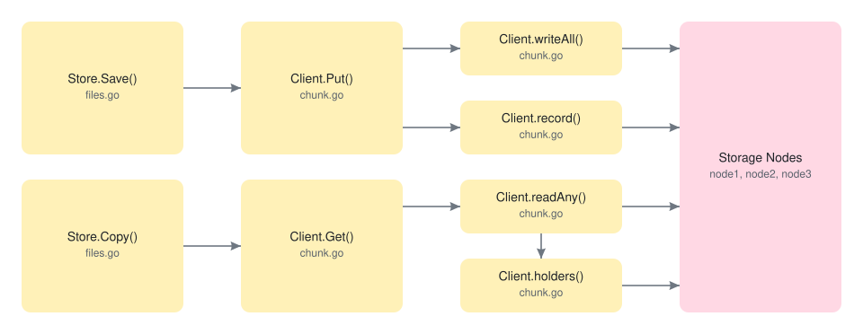

# Chunk

Stores files on the storage nodes for the API, the worker and the ingest service. It cuts each file into chunks of up to 4 MB, sends every chunk to the nodes, and records which nodes saved it in the nodes' chunk map. When the file is read, it asks the map where each chunk is and joins the chunks back together.

## Saving and Reading

| Function | Description |
| --- | --- |
| `Store.Save()` | Cuts the file into chunks, sends them to the nodes, adds each chunk to the chunk map, and records the chunk IDs in the `files` table. Saving to the same path again replaces the file. |
| `Store.Copy()` | Asks the chunk map which nodes hold each chunk, and joins the chunks back together, in order. Returns `ErrNotFound` if there's no such file. |
| `Store.Delete()` | Removes the file from the `files` table. Its chunks stay on the nodes, since another file may use the same chunks. |
| `ID()` | Names a chunk after a SHA-256 fingerprint of its bytes. If the bytes are damaged, they no longer match the name. Chunks with the same bytes get the same name, so they're stored once. |

## The `files` Table

| Column | Description |
| --- | --- |
| `path` | The file's name, such as `uploads/<id>.mp4` or `hls/<id>/720p_003.ts`. |
| `chunks` | The chunk IDs, in order. |

## Special Cases

| Case | Description |
| --- | --- |
| One Node Is Down | A chunk counts as saved once 2 of the 3 nodes have it, so uploads keep working. Reading a chunk asks the other nodes instead. The storage nodes' repair loop copies the chunk to the missing node once it's back. |
| A Node Can't Be Reached | Reaching a stopped node can take 5 seconds to fail. So the node rests for 10 seconds: new chunks skip it unless too few other nodes save them, and it's asked last when reading. |
| Two Nodes Are Down | Saving fails, since a chunk with only one copy could easily be lost. |
| A Node Sends a Damaged Chunk | The bytes no longer match the chunk's name, so they're ignored and another node is asked. |
| The Nodes Are Electing a Leader | The map replies `503`, so adding the chunk to the map is tried every second, up to 10 times in all. |
| The Map Doesn't List a Chunk | Every node is still asked, so a chunk saved before Phase 5, or one the map hasn't caught up on, can still be read. |

## Development

| Command | Description |
| --- | --- |
| `go doc -all .` | Shows every function and type with its documentation. |
| `go test ./...` | Runs the tests. They need no Docker. |

## Additional Information: How Files Become Chunks

Each file is split into its own chunks. A chunk holds up to 4 MB, so a file under 4 MB is stored as one chunk, and a larger file is split into several. Segments, the short video files FFmpeg makes for playback (4 seconds each, or 2 for a stream), are stored the same way. Most are under 4 MB, so each one is usually one chunk.

| File | Size | Chunks |
| --- | --- | --- |
| `hls/<id>/720p_000.ts` | 1 MB | One chunk. |
| `uploads/<id>.mp4` | 12 MB | Three chunks of 4 MB, in order. |
