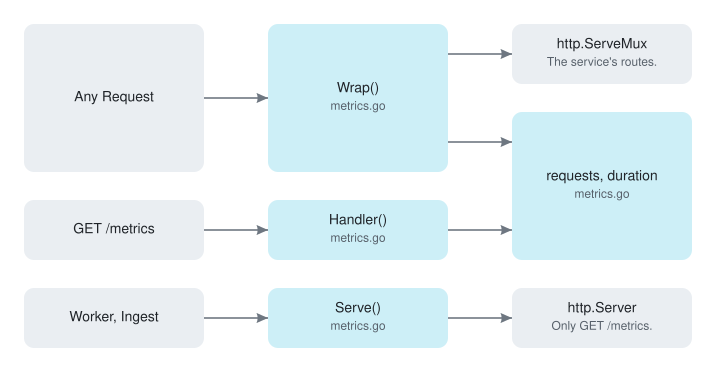

# Metrics

Counts and times the requests each service handles and serves the metrics at `/metrics` for Prometheus to collect. Every Go service uses it, so they all report requests the same way.

## Counting Requests

| Function | Description |
| --- | --- |
| `Wrap()` | Wraps a service's router, so every request is counted and timed without code in each handler. |
| `Handler()` | Serves every metric in Prometheus's text format. Each service serves it at `GET /metrics`. |
| `Serve()` | Runs a server that only serves `GET /metrics`. The worker (port 8090) and the ingest service (port 8083) use it, since they have no server of their own. |

## Metrics

| Name | Kind | Description |
| --- | --- | --- |
| `http_requests_total` | Counter | Requests handled, by `path` and `code`, such as `GET /videos/{id}` and `200`. A counter only goes up, and Prometheus works out how fast it rises. |
| `http_request_seconds` | Histogram | How long requests take, by `path`. A histogram sorts each duration into ranges, so Prometheus can work out the slowest requests. |

## Edge Cases

| Case | Description |
| --- | --- |
| A Path Holds an ID | The request is counted under its route, such as `GET /videos/{id}`, not its real path. A new label for every video would fill Prometheus's memory. |
| No Route Matches | The request is counted under the path `unmatched`. |
| The Request Becomes a WebSocket | It's counted but not timed, since it stays open as long as the viewer does. |

## Development

| Command | Description |
| --- | --- |
| `go doc -all .` | Shows every function and type with its documentation. |
| `go test ./...` | Runs the tests. They need no Prometheus or Docker. |
