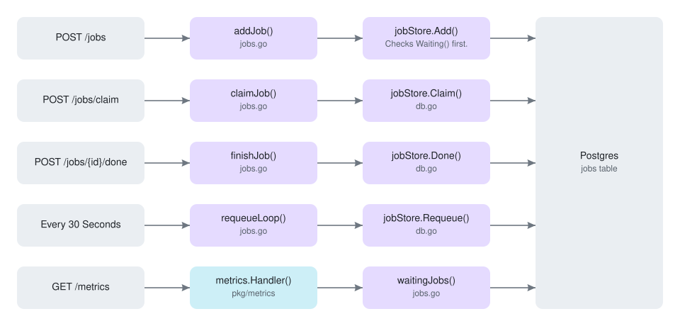

# Queue

Hands out conversion jobs to the workers one at a time. A busy worker renews its job every minute, and a job left 5 minutes without a renewal is handed out again.

## Startup

## Requests

| Request | Reply |
| --- | --- |
| `POST /jobs` | `201` with the new job. `400` for a bad body, and `429` if too many jobs are waiting. |
| `POST /jobs/claim` | `200` with the oldest waiting job. `204` if no job is waiting. |
| `POST /jobs/<id>/done` | `204` once the job is marked done. `400` for a bad ID, and `404` if there's no such job. |
| `POST /jobs/<id>/renew` | `204` once the job's 5 minutes start again. `400` for a bad ID, and `404` if there's no running job with that ID. |
| `GET /metrics` | `200` with the queue's numbers for Prometheus, including `queue_waiting_jobs`, which is counted in Postgres each time it's read. |

## Job States

| State | Description | Moves On When |
| --- | --- | --- |
| `waiting` | The job is in line for a worker. | A worker claims it, and it becomes `running`. Each claim adds 1 to its `attempts`. |
| `running` | A worker is converting the video. | The worker marks it `done`, or after 5 minutes without a renewal it goes back to `waiting`. |
| `done` | The video is converted, or the worker gave up on it. | Never. This is the end. |

## Special Cases

| Case | Description |
| --- | --- |
| The Line Is Full | `POST /jobs` replies `429` once 100 jobs are waiting, so the line can't grow forever. Two requests at the same moment can push it slightly over. |
| Two Workers Claim at Once | `FOR UPDATE SKIP LOCKED` makes the second worker skip the job the first is taking, so no job goes to two workers. |
| A Worker Crashes | Its job stops being renewed. The queue checks every 30 seconds, and puts a job left 5 minutes without a renewal back to `waiting`. |
| The Queue Restarts | Jobs are kept in Postgres, so none are lost. |

## Configuration

| Variable | Default | Description |
| --- | --- | --- |
| `PORT` | `8081` | The port the queue listens on. |
| `DATABASE_URL` | Required | Where Postgres is, such as `postgres://postgres:flick@db:5432/postgres?sslmode=disable`. |

## Development

| Command | Description |
| --- | --- |
| `go doc -cmd -u -all .` | Shows every function and type with its documentation. |
| `go test ./...` | Runs the tests. They need no Postgres or Docker. |
