# Queue

Hands out conversion jobs one at a time, and retries any job a worker doesn't finish within 5 minutes.

## Startup

## Requests

## Job States

| State | Description | Moves On When |
| --- | --- | --- |
| `waiting` | In line for a worker. | A worker claims it, and it becomes `running`. |
| `running` | A worker is converting the video. | The worker marks it `done`, or after 5 minutes it goes back to `waiting`. |
| `done` | The video is converted. | Never. This is the end. |

## Configuration

| Variable | Default | Description |
| --- | --- | --- |
| `PORT` | `8081` | The port the queue listens on. |
| `DATABASE_URL` | Required | Where Postgres is, such as `postgres://postgres:flick@db:5432/postgres?sslmode=disable`. |

## Development

| Command | Description |
| --- | --- |
| `go doc -cmd -u -all .` | Shows every function and type with its documentation. |
| `go test ./...` | Runs the tests. They need no Postgres or Docker. |
