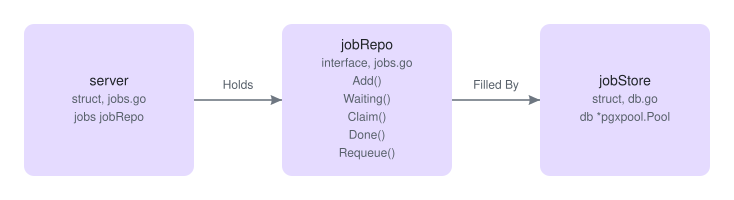

# Queue

## Startup

## Types

## Requests

## Job States

| State | Meaning | Moves On When |
| --- | --- | --- |
| `waiting` | In line for a worker. | A worker claims it, and it becomes `running`. |
| `running` | A worker is converting the video. | The worker marks it `done`, or after 5 minutes it goes back to `waiting`. |
| `done` | The video is converted. | Never. This is the end. |

## Functions

| Function | File | Belongs To | Description |
| --- | --- | --- | --- |
| `main` | main.go | | Starts the program by calling `run`. |
| `run` | main.go | | Sets everything up, serves requests, and shuts down cleanly. |
| `getenv` | main.go | | Reads a setting, or returns a default. |
| `connectDB` | db.go | | Opens the database pool and creates the `jobs` table. |
| `pingWithRetry` | db.go | | Waits until Postgres is ready, trying up to 10 times. |
| `Add` | db.go | `jobStore` | Adds a waiting job for a video. |
| `Waiting` | db.go | `jobStore` | Counts the jobs no worker has taken yet. |
| `Claim` | db.go | `jobStore` | Hands out the oldest waiting job, so two workers never get the same one. |
| `Done` | db.go | `jobStore` | Marks a job done. |
| `Requeue` | db.go | `jobStore` | Puts jobs held for too long back in line. |
| `newServer` | jobs.go | | Builds a `server` from a `jobStore`. |
| `routes` | jobs.go | `server` | Connects each URL to its handler. |
| `health` | jobs.go | `server` | Replies `ok`. |
| `addJob` | jobs.go | `server` | Adds a job, or replies 429 if 100 are already waiting. |
| `claimJob` | jobs.go | `server` | Gives a worker the next job, or replies 204 if there's none. |
| `finishJob` | jobs.go | `server` | Marks a job done. |
| `requeueLoop` | jobs.go | `server` | Every 30 seconds, puts jobs held for over 5 minutes back in line. |
| `internalError` | jobs.go | | Logs an error and replies with a 500. |
| `writeJSON` | jobs.go | | Sends data as JSON. |
