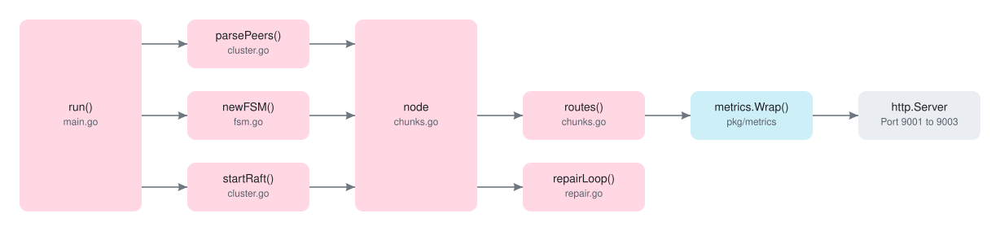

# Storage

Saves chunks of files on its own disk and returns them on request. Three nodes run at once, each with a copy of every chunk, so any one node can fail and nothing is lost. Raft keeps their chunk map, which lists the nodes holding each chunk, the same on every node. One node, the leader, makes every change to the map and copies chunks to any node that's missing them.

## Startup

## Requests

| Request | Response |
| --- | --- |
| `PUT /chunks/<id>` | `204` once the chunk is saved. `400` if the chunk's bytes don't match its ID. `413` if it's over 4 MB. |
| `GET /chunks/<id>` | `200` with the chunk. `404` if the node doesn't have it. `500` if its copy is corrupted. |
| `GET /chunks` | `200` with the ID of every chunk the node has saved, such as `["3da6...","9b1c..."]`. |
| `POST /map` | `204` once a majority of the nodes (2 of 3) have saved the change, such as `{"op":"add","chunk_id":"3da6...","nodes":["http://node1:9001"]}`. A follower returns `307` with the leader's address. `400` for a bad change. `503` while the nodes elect a leader. |
| `GET /status` | `200` with the node's name, its Raft state and the leader, such as `{"id":"node2","leader":"node1","state":"Follower"}`. |
| `GET /map/<id>` | `200` with the nodes that hold the chunk, such as `["http://node1:9001","http://node3:9003"]`. `404` if the map doesn't list the chunk. |
| `GET /metrics` | `200` with the node's metrics for Prometheus, including `raft_is_leader` (1 on the leader, 0 on the others) and `chunks_stored`. |

## Repairs

## Map Changes

| Field | Description |
| --- | --- |
| `op` | `add` if the nodes now hold the chunk, or `remove` if they no longer do. |
| `chunk_id` | The chunk's ID. |
| `nodes` | The addresses of the nodes, such as `http://node1:9001`. |

## Edge Cases

| Case | Description |
| --- | --- |
| The Same Chunk Is Saved Twice | The second save replaces the first. The bytes are the same, so nothing changes. |
| The Node Crashes Mid-Save | Each save writes a `.tmp` file first, then renames it. A crash leaves a stray `.tmp` file, never half a chunk. |
| A Chunk Is Corrupted on Disk | The node deletes its copy and returns `500` instead of sending bad data. The client tries the next node. |
| A Node Is Missing a Chunk | This happens when the node was down during an upload, or lost its copy. Every 5 seconds, the leader asks each node which chunks it has and copies over any that are missing. Every node runs this repair loop, but only the leader does any work. |
| The Leader Fails | The leader sends a heartbeat many times a second. When the heartbeats stop, the others elect a new leader within a few seconds. Changes sent in the meantime get `503`, and the client retries. |
| A Node Restarts | It reloads its map from the copy Raft saved in `/chunks/raft/`, then gets every change it missed from the leader. |
| Two Nodes Are Down | Raft needs 2 of the 3 nodes to agree, so no change can be saved and no leader can be elected. Uploads fail until a second node is back. |

## Configuration

| Variable | Default | Description |
| --- | --- | --- |
| `NODE_ID` | `node1` | The node's name. It must match a host in `STORAGE_NODES`. |
| `STORAGE_NODES` | `http://node1:9001,http://node2:9002,http://node3:9003` | The storage nodes' URLs, this one included, separated by commas. Each node takes Raft messages on its port plus 1000, such as `10001`. |
| `BOOTSTRAP` | `false` | Set to `true` on exactly one node, which sets up the cluster on its first start. Compose sets it on `node1`. |
| `CHUNK_DIR` | `/chunks` | The folder chunks are saved to. Each node has its own Docker volume here. |

## Development

| Command | Description |
| --- | --- |
| `go doc -cmd -u -all .` | Shows every function and type with its documentation. |
| `go test ./...` | Runs the tests. Raft runs for real over an in-memory network, so they need no Docker. |
