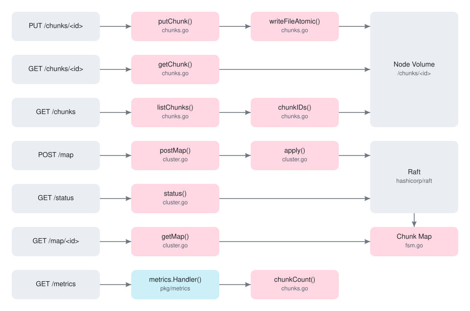

# Storage

Saves chunks of files on its own disk and hands them back. Three nodes run at once, and every chunk is sent to all of them, so any one node can fail and nothing is lost.

## Startup

## Requests

| Request | Reply |
| --- | --- |
| `PUT /chunks/<id>` | `204` once the chunk is saved. `400` if the chunk's bytes don't match its ID, and `413` if it's over 4 MB. |
| `GET /chunks/<id>` | `200` with the chunk. `404` if the node doesn't have it, and `500` if its copy is damaged. |

## Special Cases

| Case | Description |
| --- | --- |
| The Same Chunk Is Saved Twice | The second save replaces the first. The bytes are the same, so nothing changes. |
| The Node Crashes Mid-Save | Each save writes a `.tmp` file first, then renames it. A crash leaves a stray `.tmp` file, never half a chunk. |
| A Chunk Is Damaged on Disk | The node replies `500` instead of sending bad data, and the client asks the next node. |
| The Node Was Down During an Upload | The node never gets that upload's chunks, and nothing copies them over later. Phase 5 fixes this. |

## Configuration

| Variable | Default | Description |
| --- | --- | --- |
| `NODE_ID` | `node1` | The node's name, shown in its logs. |
| `PORT` | `9001` | The port the node listens on. |
| `CHUNK_DIR` | `/chunks` | The folder chunks are saved to. Each node has its own Docker volume here. |

## Development

| Command | Description |
| --- | --- |
| `go doc -cmd -u -all .` | Shows every function and type with its documentation. |
| `go test ./...` | Runs the tests. They need no Docker. |
