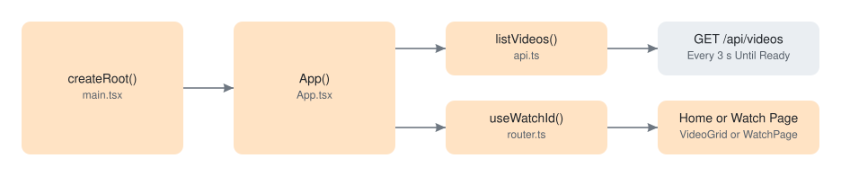

# Web

Uploads, lists and plays videos with adaptive streaming. It also plays live streams with chat beside them and shows creators how many people watch each video. It's built with React.

## Startup

## Playback

## Chat

## Creator Dashboard

## Pages

Every page has the same header: the name, which links home, an Upload button and a link to the creator dashboard. The Upload button opens the upload form in a dialog. Once a video has uploaded, the dialog closes and the home page shows the new video.

| Page | Address | Description |
| --- | --- | --- |
| Home | `/` | Shows every video, newest first. With no videos yet, it shows a button that opens the upload form. |
| Watch | `/watch?v=<id>` | Plays one video, with the other videos beside it. A live stream has its chat beside it instead. A video still processing, or one that couldn't be converted, shows a message in place of the player. |
| Creator Dashboard | `/dashboard` | Shows every video's views and watch time in hours and minutes, newest first. |

## Server Requests

| Request | Description |
| --- | --- |
| `GET /api/videos` | Lists every video. Sent again every 3 seconds while any video is processing or live. |
| `POST /api/videos` | Uploads a video and shows its progress. |
| `GET /hls/<id>/master.m3u8` | Starts playback. hls.js then fetches each quality's playlist and segments from `/hls/<id>/`. It switches to the best quality the connection can keep up with. |
| `GET /hls/<id>/live.m3u8` | Starts a live stream. hls.js fetches it again every few seconds to find new segments. |
| `GET /hls/<id>/poster.jpg` | The thumbnail, also shown before playback starts. |
| `GET /api/chat/<id>` | Opens a WebSocket to a live stream's chat. If it drops, it reconnects 3 seconds later. |
| `POST /api/videos/<id>/view` | Counts a view when a video first starts playing. |
| `POST /api/videos/<id>/watch` | Adds watch time after every 30 seconds of playback and sends the rest when the viewer leaves or closes the tab. Failures are ignored. |
| `GET /api/stats` | Lists every video's views and watch time for the dashboard. Sent again every 30 seconds. |

## Development

| Command | Description |
| --- | --- |
| `npm install` | Installs the packages. |
| `npm run dev` | Runs the website at http://localhost:5173 and proxies `/api` (chat included) and `/hls` to the Docker stack. |
| `npm run build` | Type-checks and builds the website into `dist/`, which Nginx serves. |
| `npm run lint` | Checks the code with oxlint. |
