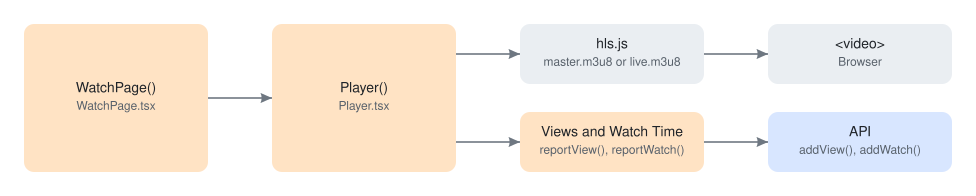

# Web

Uploads videos, lists them, and plays them with adaptive streaming. It's built with React.

## Startup

## Playback

## Pages

| Page | Address | Description |
| --- | --- | --- |
| Home | `/` | Shows the upload form and every video, newest first. |
| Watch | `/watch?v=<id>` | Plays one video, with the other videos beside it. |

## Server Requests

| Request | Description |
| --- | --- |
| `GET /api/videos` | Lists every video. Sent again every 3 seconds while any video is processing. |
| `POST /api/videos` | Uploads a video, with progress shown as it sends. |
| `GET /hls/<id>/master.m3u8` | Starts playback. hls.js then fetches each quality's playlist and segments from `/hls/<id>/`. |
| `GET /hls/<id>/poster.jpg` | Shows a still image as the thumbnail and before playback starts. |

## Development

| Command | Description |
| --- | --- |
| `npm install` | Installs the packages. |
| `npm run dev` | Runs the site at http://localhost:5173, passing `/api` and `/hls` to the Docker stack. |
| `npm run build` | Type-checks and builds the site into `dist/`, which Nginx serves. |
| `npm run lint` | Checks the code with oxlint. |

## Additional Information: Adaptive Streaming

hls.js handles buffering, choosing a quality and feeding the player, using its default settings. It times each segment download and switches to the best quality the connection can keep up with. To change how it behaves, pass options to `new Hls()` in `Player.tsx`.
