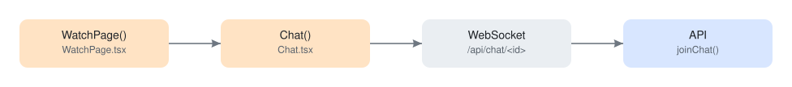
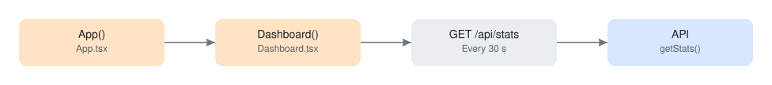

# Web

The website, built with React. It uploads, lists and plays videos with adaptive streaming, plays live streams with chat beside them, and shows creators how many people watch each video.

## Startup

## Playback

## Chat

## Creator Dashboard

## Pages

| Page | Address | Description |
| --- | --- | --- |
| Home | `/` | Shows the upload form and every video, newest first. |
| Watch | `/watch?v=<id>` | Plays one video, with the other videos beside it. A live stream has its chat beside it instead. A video still processing, or one that couldn't be converted, shows a message in place of the player. |
| Creator Dashboard | `/dashboard` | Shows every video's views and watch time in hours and minutes, newest first. |

## Server Requests

| Request | Description |
| --- | --- |
| `GET /api/videos` | Lists every video. Sent again every 3 seconds while any video is processing or live. |
| `POST /api/videos` | Uploads a video, with progress shown as it sends. |
| `GET /hls/<id>/master.m3u8` | Starts playback. hls.js then fetches each quality's playlist and segments from `/hls/<id>/`. |
| `GET /hls/<id>/live.m3u8` | Starts a live stream. hls.js fetches it again every few seconds to find new segments. |
| `GET /hls/<id>/poster.jpg` | Shows a still image as the thumbnail and before playback starts. |
| `GET /api/chat/<id>` | Opens a WebSocket to a live stream's chat. If it drops, it's opened again 3 seconds later. |
| `POST /api/videos/<id>/view` | Counts a view, the first time a video starts playing. |
| `POST /api/videos/<id>/watch` | Adds watch time, after every 30 seconds of playback, and with whatever is left when the viewer leaves or closes the tab. A failure is ignored. |
| `GET /api/stats` | Lists every video's views and watch time for the dashboard. Sent again every 30 seconds. |

## Development

| Command | Description |
| --- | --- |
| `npm install` | Installs the packages. |
| `npm run dev` | Runs the website at http://localhost:5173, passing `/api` (chat included) and `/hls` to the Docker stack. |
| `npm run build` | Type-checks and builds the website into `dist/`, which Nginx serves. |
| `npm run lint` | Checks the code with oxlint. |

## Additional Information: Adaptive Streaming

| Topic | Description |
| --- | --- |
| What hls.js Does | Downloads segments ahead, picks a quality and feeds the player. It times each download and switches to the best quality the connection can keep up with. |
| Safari | Plays HLS on its own, so it's given the playlist directly, without hls.js. |
| Settings | Only `liveSyncDuration` is changed from the defaults. It keeps a live stream playing 6 seconds behind the newest segment. |
| Changing It | Pass options to `new Hls()` in `Player.tsx`. |
