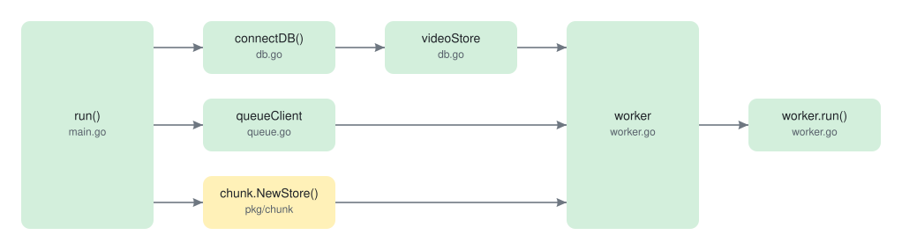

# Worker

Claims jobs from the queue, converts each upload to HLS in 1080p, 720p and 360p, and marks the video ready.

## Startup

## Job Steps

## Special Cases

| Case | Description |
| --- | --- |
| No Job Is Waiting | Waits 2 seconds, then asks again. |
| A Step Fails | Leaves the job unfinished. The queue hands it out again after 5 minutes. |
| The Worker Is Stopped | Stops FFmpeg. `master.m3u8` isn't written, so the video stays `processing`. The queue hands the job out again after 5 minutes, and the next try overwrites the leftover files. |
| The Upload Is Shorter Than a Quality | Skips that quality. A 720p upload gets 720p and 360p. An upload under 360p gets one quality at its own height. |

## Data Files

| File | Path | Description |
| --- | --- | --- |
| Upload | `/data/<id>.mp4` | Saved by the API. |
| Quality Playlist | `/data/hls/<id>/720p.m3u8` | Made by FFmpeg, one per quality. |
| Segments | `/data/hls/<id>/720p_000.ts`, `720p_001.ts` and so on | Made by FFmpeg, 4 seconds each. |
| Poster | `/data/hls/<id>/poster.jpg` | Made by FFmpeg from a frame 1 second in. |
| Master Playlist, In Progress | `/data/hls/<id>/master.m3u8.part` | Written by `writeFileAtomic`. |
| Master Playlist, Finished | `/data/hls/<id>/master.m3u8` | Renamed from the `.part` file once it's complete. It's written last, so once it exists, every other file is finished. |

## Qualities

| Quality | Height | Bandwidth | Video Bit Rate |
| --- | --- | --- | --- |
| `1080p` | 1080 | 5 Mbps | 4.872 Mbps |
| `720p` | 720 | 2.8 Mbps | 2.672 Mbps |
| `360p` | 360 | 0.8 Mbps | 0.672 Mbps |

## Configuration

| Variable | Default | Description |
| --- | --- | --- |
| `QUEUE_URL` | `http://queue:8081` | Where the queue is. |
| `DATA_DIR` | `/data` | The folder with uploads, and where HLS files are written. |
| `DATABASE_URL` | Required | Where Postgres is, such as `postgres://postgres:flick@db:5432/postgres?sslmode=disable`. |

## Development

| Command | Description |
| --- | --- |
| `go doc -cmd -u -all .` | Shows every function and type with its documentation. |
| `go test ./...` | Runs the tests. They need no Postgres or Docker, and `TestConvertToHLS` is skipped if FFmpeg isn't installed. |
