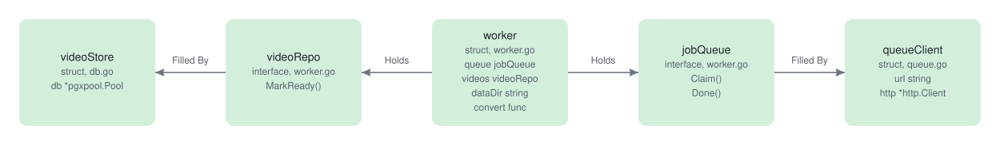

# Worker

## Startup

## Types

## Job Steps

| When | What Happens |
| --- | --- |
| No job is waiting | Waits 2 seconds, then asks again. |
| A step fails | Leaves the job unfinished. The queue hands it out again after 5 minutes. |
| The worker is stopped | Stops FFmpeg and deletes its half-written file. The queue hands the job out again after 5 minutes. |

## Files

| File | Path | Made By |
| --- | --- | --- |
| Upload | `/data/<id>.mp4` | The API |
| 720p copy, in progress | `/data/<id>_720p.mp4.part` | FFmpeg |
| 720p copy, finished | `/data/<id>_720p.mp4` | Renaming the `.part` file once FFmpeg is done |

## Functions

| Function | File | Belongs To | Description |
| --- | --- | --- | --- |
| `main` | main.go | | Starts the program by calling `run`. |
| `run` | main.go | | Sets everything up, starts the work loop, and stops cleanly. |
| `getenv` | main.go | | Reads a setting, or returns a default. |
| `connectDB` | db.go | | Opens the database pool. The API creates the tables. |
| `pingWithRetry` | db.go | | Waits until Postgres is ready, trying up to 10 times. |
| `MarkReady` | db.go | `videoStore` | Sets a video's status to `ready`. |
| `run` | worker.go | `worker` | Does one job after another until the worker is stopped. |
| `next` | worker.go | `worker` | Claims one job and does it. |
| `process` | worker.go | `worker` | Converts the video, marks it ready, and marks the job done. |
| `uploadPath` | worker.go | `worker` | Builds the upload's path, such as `/data/<id>.mp4`. |
| `convertedPath` | worker.go | `worker` | Builds the 720p copy's path, such as `/data/<id>_720p.mp4`. |
| `convertTo720p` | worker.go | | Runs FFmpeg to make a 720p copy. |
| `sleep` | worker.go | | Waits, but stops early if the worker is stopped. |
| `Claim` | queue.go | `queueClient` | Asks the queue for the oldest waiting job. |
| `Done` | queue.go | `queueClient` | Tells the queue a job is finished. |
| `post` | queue.go | `queueClient` | Sends an empty POST request to the queue. |
